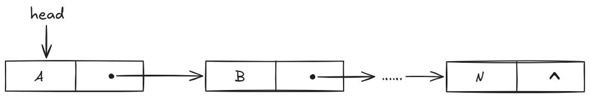
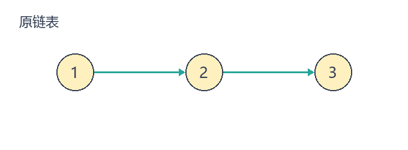
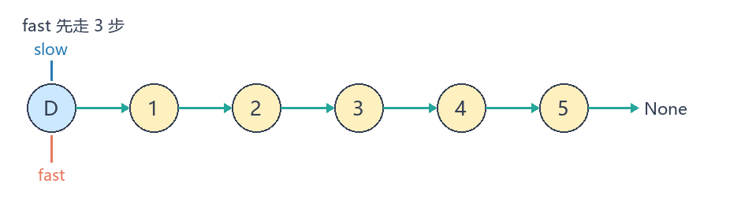

# 【力扣 LeetCode】19. 删除链表的倒数第 N 个结点：从两次遍历到快慢指针｜Python

> 刷题日期：2026-11-19  
> 原题链接：[19. 删除链表的倒数第 N 个结点](https://leetcode.cn/problems/remove-nth-node-from-end-of-list/)  
> 难度：中等  
> 语言：Python  
> 关键词：单链表、两次遍历、快慢指针、哑节点

## 1. 题意与示例

给定单链表的头节点 `head` 和整数 `n`，删除倒数第 `n` 个节点，返回删除后的链表头节点。题目保证至少有一个节点，且 `n` 不超过链表长度。返回的是**头节点对象**，不是节点值或列表。

## 2. 前置知识

### 2.1 单链表的节点、head 与 next

单链表由节点依次连接。每个节点的 `val` 保存值，`next` 指向下一个节点；最后一个节点的 `next` 是 `None`。


`head` 指向第一个节点。令 `index = head` 后，可以不断执行 `index = index.next` 来遍历链表；这只会移动 `index`，不会改变 `head`。



### 2.2 删除节点：修改前一个节点的 `next`

假设链表是 `1 → 2 → 3`。要删除节点 `2`，让节点 `1` 的 `next` 直接指向节点 `3` 即可，也就是让链表跳过 `2`。因此，删除时通常要先找到**待删除节点的前一个节点**。



### 2.3 删除头节点与哑节点

如果要删除的是节点 `1`，它没有前一个节点。两次遍历法可以直接返回 `head.next`。快慢指针法则在 `head` 前面放一个临时的 `dummy` 节点，让原头节点也有“前一个节点”，最后返回 `dummy.next`。

## 3. 解题思路

### 3.1 我的初始想法：两次遍历

我最初想到的是先求链表长度，再把“倒数第几个”换算为“正数第几个”，最后找到待删除节点的前驱并修改 `next`。这条思路可行，关键边界是头节点没有前驱。

第一次从 `head` 走到 `None`，数出链表长度 `length`。倒数第 `n` 个节点就是正数第 `length - n + 1` 个。如果用从 `0` 开始的下标，它的位置是 `length - n`，它的前一个节点位置就是 `length - n - 1`。

在 `1 → 2 → 3 → 4 → 5`、`n = 2` 中，`length = 5`，前一个节点的下标为 `5 - 2 - 1 = 2`，也就是节点 `3`。第二次遍历停在 `3`，令 `3.next` 指向原来 `4.next` 所指的 `5`，就跳过了 `4`。不需要额外设置一个“后一个节点”指针。

### 3.2 补充方法：快慢指针

如果在头节点前加一个哑节点  `dummy`，删除原头节点时也能找到它的前一个节点。令 `slow`、`fast` 都从 `dummy` 出发，先让 `fast` 走 `n + 1` 步，随后两者每轮各走一步，直到 `fast` 到达 `None`。两者始终相隔 `n + 1` 步，所以这时 `slow` 恰好在待删除节点的前一个节点。

沿用 `1 → 2 → 3 → 4 → 5`、`n = 2`：起初两个指针在 `dummy`，`fast` 先走 3 步到节点 `3`；之后两者同步移动 3 步，`fast` 到达 `None`，`slow` 到达节点 `3`。此时 `slow.next` 是待删除的 `4`，可以直接修改 `slow.next`。



## 4. Python 代码实现与执行过程

### 4.1 我的两次遍历解法

下面保留我在力扣提交成功的写法。力扣环境已提供 `ListNode` 定义。

```python
class Solution:
    def lenLNode(self, head: ListNode) -> int:
        num = 0
        index = head

        while index is not None:
            num += 1
            index = index.next

        return num

    def removeNthFromEnd(self, head: ListNode | None, n: int) -> ListNode | None:
        index = head
        length = self.lenLNode(head)
        pos = 0

        if length - n - 1 == -1:
            return head.next

        while pos != length - n - 1:
            index = index.next
            pos += 1
        index.next = index.next.next

        return head
```

`lenLNode` 逐个访问节点并计数。`pos` 是第二次遍历中 `index` 所在的从 `0` 开始的下标。删除头节点时直接返回 `head.next`；其他情况则移动到 `length - n - 1`，再让前驱节点越过待删除节点。以五节点例子为例，`pos` 从 `0` 走到 `2`，`index` 停在节点 `3`，最终结果是 `1 → 2 → 3 → 5`。

### 4.2 快慢指针解法

```python
class Solution:
    def removeNthFromEnd(self, head: ListNode | None, n: int) -> ListNode | None:
        dummy = ListNode()
        dummy.next = head
        slow = fast = dummy

        for _ in range(n + 1):
            fast = fast.next

        while fast:
            slow = slow.next
            fast = fast.next

        slow.next = slow.next.next
        return dummy.next
```

先行循环建立 `n + 1` 步的间隔。同步循环保持间隔不变，直到 `fast` 走到链表末尾之后的 `None`。这时 `slow.next` 是待删除节点，修改引用后返回 `dummy.next`。即使原头节点被删除，返回值也会自动变成新头节点。

## 5. 复杂度分析

设链表长度为 `L`。两次遍历法先走 `L` 个节点求长度，再最多走 `L - 1` 步找前驱，时间复杂度为 `O(L)`；只保存几个变量，额外空间复杂度为 `O(1)`。

快慢指针法中，`fast` 先走 `n + 1` 步，之后两指针同步走，整体仍是 `O(L)` 时间。`dummy` 和两个指针只占固定数量的额外空间，所以空间复杂度也是 `O(1)`。两种方法都属于线性时间；单次力扣提交的毫秒数会波动，不能只凭它断言哪一种总是更快。

## 后记

两次遍历法清楚地把倒数位置换成正数位置，适合先建立正确思路；快慢指针法用 `n + 1` 的间隔直接把 `slow` 定位到前驱，配合哑节点统一处理删除头节点。无论用哪种写法，核心都是找到要修改 `next` 的那个节点，并返回删除后的头节点。
