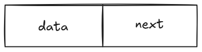
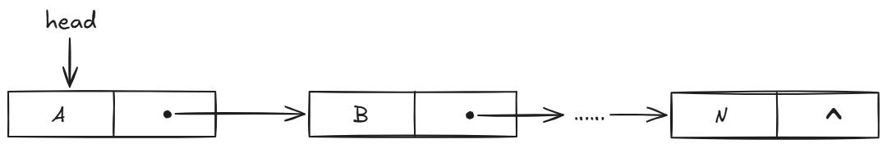
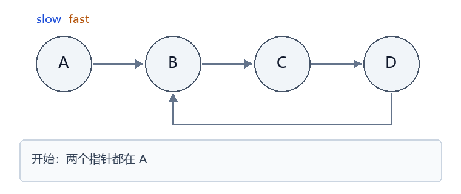
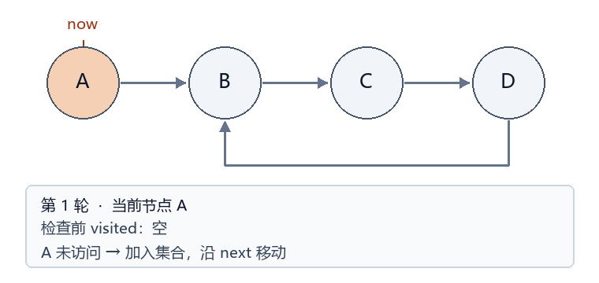

# 【力扣】142. 环形链表 II ｜Python

> 日期：2026-11-16  
> 原题链接：[142. 环形链表 II 原题连接](https://leetcode.cn/problems/linked-list-cycle-ii/)  
> 难度：中等  
> 语言：Python  
> 关键词：单链表、环、集合、快慢指针

## 1. 题意与示例

给定单链表的头节点 `head`，如果链表有环，返回**环的入口节点对象**；如果没有环，返回 `None`。题目示例中的 `pos` 只用于描述尾节点接回的位置，并不是函数参数。

例如，`A(3) → B(2) → C(0) → D(-4) → B(2) → …`。从 `A` 出发，第一次进入环的位置是 `B`，所以返回节点 `B`，而非它的值 `2` 或索引 `1`。

## 2. 前置知识

### 2.1 节点和 next

单链表由节点连接而成，其单个节点结构如下图所示：


每个节点的 `val` 保存数值，`next` 指向下一个节点；`next` 为 `None` 表示走到了末尾。
 `head` 是第一个节点，如图所示：


对于一个链表我们可以建立一个指针`now`，使得`now = head` 让变量 `now` 也指向第一个节点，便于后续的遍历，这这样之后执行 `now = now.next`，移动的就是 `now`，并不会改动 `head`。

### 2.2 节点与节点值不是一回事

两个不同节点完全可以都保存数值 `2`。
题目要求找到的是再次到达的**同一个节点对象**，所以不能仅凭 `now.val` 判断是否形成环。返回答案时也应写 `return now`，而不是 `return now.val`。

### 2.3 集合记录访问状态

Python 的 `set` 可以保存已经访问的节点。`now in visited` 检查当前节点是否来过，`visited.add(now)` 把它记下来。力扣提供的 `ListNode` 对象可以直接用于这里的集合。每一轮按“检查 → 记录 → 移动”的顺序进行。

## 3. 解题思路

### 3.1 我的初始想法：记录访问过的节点

最初我想随着指针移动给位置计数。但计数只会不断增加，即使走回旧节点，也无法仅凭步数认出它。于是我想到给访问过的位置设置 `flag`。由于函数只收到 `head`，没有预先编号的节点数组，我改用集合保存访问过的节点对象。

让 `now` 从 `head` 开始，先检查是否访问过，再记录，最后移到 `now.next`。如果走到 `None`，说明无环；如果第一次遇到已访问节点，就返回它。从头沿 `next` 第一次进入环后，要绕完整个环才能再次到达旧节点，因此**首次重复的节点正是入口**。

### 3.2 补充：快慢指针为什么能找到入口

集合方法需要保存访问记录。快慢指针只保留两个节点引用：`slow` 每轮走一步，`fast` 每轮走两步。无环时，`fast` 会走到链表末尾；有环时，两者进入环后，`fast` 每轮比 `slow` 多走一步。把环看成一条循环跑道，两者在环上的距离每轮缩短一步，最终会在某个节点相遇。

先沿用 `A → B → C → D → B`。环的入口是 `B`，环长为 3。两指针从 `A` 出发：

| 阶段 | `slow` | `fast` | 发生了什么 |
| --- | --- | --- | --- |
| 开始 | A | A | 都从头节点出发 |
| 第 1 轮 | B | C | 慢指针走 1 步，快指针走 2 步 |
| 第 2 轮 | C | B | 继续按各自速度走 |
| 第 3 轮 | D | D | 第一次相遇，退出第一段循环 |
| 重置 | A | D | 只把 `slow` 放回头节点 |
| 再走 1 步 | B | B | 两者在入口相遇 |



这个例子里，头节点到入口有 1 步；第一次相遇点 `D` 沿环走到入口 `B` 也只需 1 步。所以重置后两者同速走一步，正好都到 `B`。

更一般地，设头到入口为 `a`，入口到相遇点为 `b`，环长为 `L`。相遇时慢指针可能已经多绕了 `m` 圈，因此走过的总路程是 `a + b + mL`。快指针走了它的两倍，所以快指针走过的总路程是 `2(a + b + mL)`。因为两者停在环中的**同一个节点**，快指针多走的路必然是完整的 `k` 圈，即 `kL`。两者的路程差恰好又等于慢指针走过的路程，所以：

```text
a + b + mL = kL
a = (k - m)L - b
```

从相遇点走 `L - b` 步会到入口；之后每多走一整圈，仍会回到入口。上式说明从相遇点再走 `a` 步也会到入口。同时，从 `head` 走 `a` 步同样到入口。这就是把 `slow` 重置到 `head` 后，让两个指针每轮各走一步，最终会在入口相遇的原因。`k` 和 `m` 只用来说明整圈数，代码不需要计算它们。

快慢指针的优势是额外空间 `O(1)`。单次提交的运行时间和击败百分比会波动，不能仅凭它们判断哪段代码必然更快。

## 4. Python 代码实现与执行过程

### 4.1 我的集合解法

先看这个逐步动画。箭头表示节点的 `next`，下方回环表示 `D.next` 指向 `B`；蓝色节点已访问，橙色节点是当前的 `now`。



图中的访问顺序是 `A → B → C → D → B`。第二次到 `B` 时，代码尚未把它重新加入集合，而是先检查并直接返回，代码如下：

```python
class Solution:
    def detectCycle(self, head: Optional[ListNode]) -> Optional[ListNode]:
        now = head
        visited = set()

        while now is not None:
            if now in visited:
                return now
            visited.add(now)
            now = now.next
```
沿用图中的例子，逐轮执行如下：

| 轮次 | 检查前的 `now` | 检查前的 `visited` | 操作 |
| --- | --- | --- | --- |
| 1 | `A` | `{}` | 加入 `A`，移到 `B` |
| 2 | `B` | `{A}` | 加入 `B`，移到 `C` |
| 3 | `C` | `{A, B}` | 加入 `C`，移到 `D` |
| 4 | `D` | `{A, B, C}` | 加入 `D`，移到 `B` |
| 5 | `B` | `{A, B, C, D}` | 已访问，返回节点 `B` |

表中的集合排列仅用于展示，Python 集合本身不保证按加入顺序排列。若没有环，`now` 最终变成 `None`，循环结束后返回 `None`。

我先写出的版本没有最后一行 `return None`，Python 也会隐式返回 `None`。补上这行后，无环分支的意图更明确，最终代码：
```python
class Solution:
    def detectCycle(self, head: Optional[ListNode]) -> Optional[ListNode]:
        now = head
        visited = set()

        while now is not None:
            if now in visited:
                return now
            visited.add(now)
            now = now.next

        return None
```

### 4.2 快慢指针补充解法
下面这段是我在力扣看到的参考代码，用来理解快慢指针法，供读者参考：

```python
class Solution:
    def detectCycle(self, head: Optional[ListNode]) -> Optional[ListNode]:
        slow = head
        fast = head

        while fast is not None and fast.next is not None:
            slow = slow.next
            fast = fast.next.next
            if slow is fast:
                break
        else:
            return None

        slow = head
        while slow is not fast:
            slow = slow.next
            fast = fast.next

        return slow
```

这里的 `while ... else` 表示：只有循环正常结束、没有执行 `break` 时，才返回 `None`。相遇后重置 `slow`，两个指针改为每轮各走一步，重逢处就是入口。


## 5. 复杂度分析

| 方法 | 时间复杂度 | 额外空间复杂度 | 
| --- | --- | --- |
| 访问集合 | `O(n)` | `O(n)` | 
| 快慢指针 | `O(n)` | `O(1)` | 


## 6. 易错点与复盘

- 返回的是入口**节点对象**，不是 `val`，也不是示例里的 `pos`。
- 集合保存节点本身；仅保存节点值会把值相同的不同节点混淆。
- 集合解法要先检查、后加入、再移动。如果先移动，容易漏掉当前节点或把判断顺序写乱。
- 快慢指针有更好的空间复杂度，但最优应说明比较维度，不能只根据一次提交的运行时间判断。

下次遇到沿指针走时是否重复到达某处的问题，我会先考虑访问记录；若题目要求常数额外空间，再尝试利用指针速度差和环的性质。


## 参考资料

- [力扣 142：环形链表 II](https://leetcode.cn/problems/linked-list-cycle-ii/)
- [Python 文档：集合类型](https://docs.python.org/3/library/stdtypes.html#set-types-set-frozenset)
